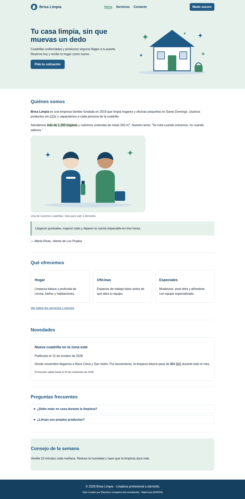
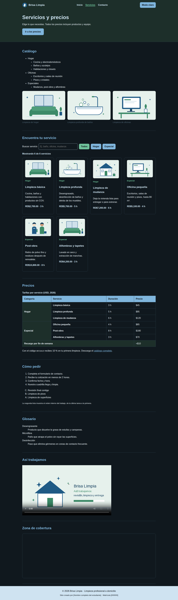
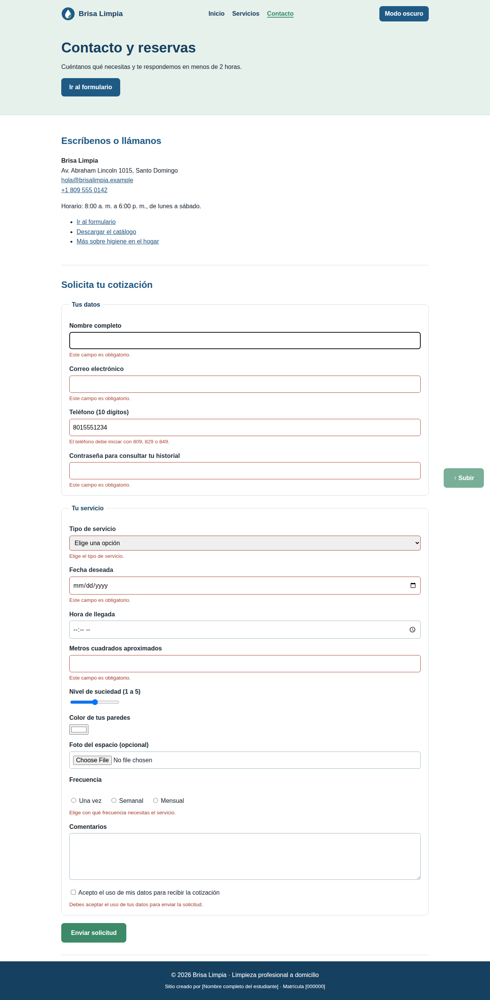
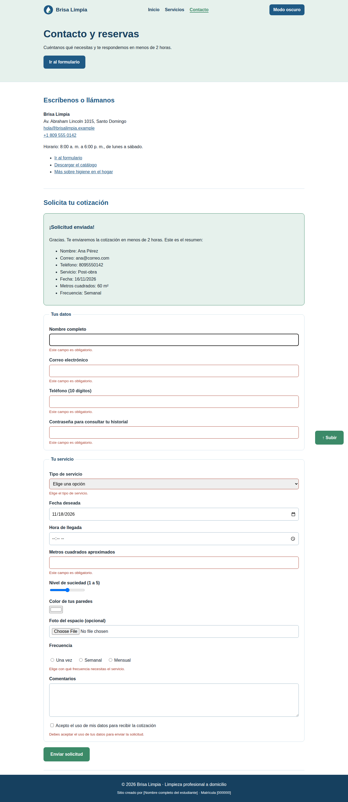
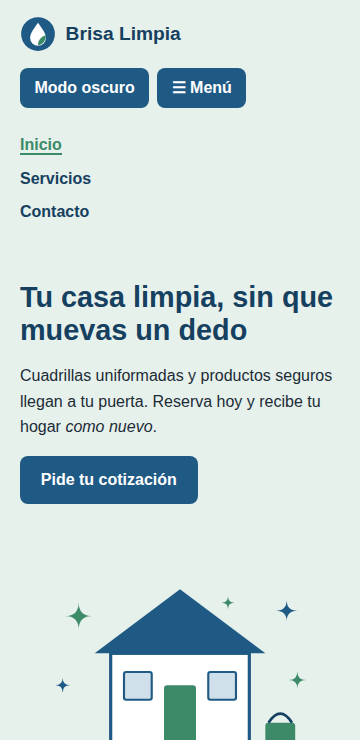

# Brisa Limpia · Limpieza profesional a domicilio

Sitio de tres páginas sobre un servicio de limpieza a domicilio: HTML5 semántico, CSS propio y JavaScript puro (sin frameworks ni librerías).

**Sitio publicado:** https://USUARIO.github.io/NOMBRE-DEL-REPOSITORIO/
**Autor:** [Nombre completo del estudiante] · Matrícula [000000]

## Capturas

## Mapa de etiquetas

| Familia | Página y sección | Etiquetas usadas | ¿Por qué esa etiqueta? |
|---|---|---|---|
| Cimientos | Las tres | doctype, html lang, meta charset, meta viewport, meta description, title | Sin ellas el navegador no sabe el idioma ni la codificación, y el sitio no se ve bien en celular. Cada título y descripción es distinto para que Google distinga las páginas. |
| Estructura semántica | Las tres; en `index.html`, “Novedades” y “Consejo de la semana” | header, nav, main, section, article, aside, footer, time, address | Cada una dice qué es el contenido: la noticia es un `article` porque se entiende sola; el consejo es un `aside` porque complementa, no es lo principal. |
| Texto con significado | `index.html`, “Quiénes somos” y “Novedades”; `servicios.html`, “Precios” | strong, em, mark, abbr, del, ins, small, sup, code | `strong` marca el nombre de la empresa, `del`/`ins` muestran el precio anterior y el nuevo, `abbr` explica la sigla COV y `sup` escribe m². |
| Citas | `index.html`, “Quiénes somos” | blockquote, cite, q | El testimonio de una clienta es una cita larga (`blockquote`) con su autora en `cite`; el lema es una cita corta dentro del párrafo (`q`). |
| Listas | `servicios.html`, “Catálogo”, “Cómo pedir” y “Glosario”; `index.html`, “Qué ofrecemos” | ul anidada, ol con start/reversed/type, dl | El catálogo no tiene orden (`ul`) y los servicios tienen subtipos (anidada). Los pasos para pedir sí tienen orden (`ol`). El glosario es término + definición (`dl`). |
| Enlaces | `contacto.html`, “Escríbenos o llámanos”; `servicios.html`, “Precios” | a con href, mailto, tel, #id, download, target="_blank" con rel="noopener" | Cada tipo de enlace hace algo distinto: abrir el correo, marcar el teléfono, saltar al formulario, bajar el catálogo o salir a otro sitio sin perder el nuestro. |
| Multimedia | `servicios.html`, “Catálogo”, “Así trabajamos” y “Zona de cobertura”; `index.html`, “Quiénes somos” | img con alt, figure, figcaption, video, source, iframe con title | `figure` agrupa cada imagen con su pie; `video` con `controls` deja al usuario decidir si lo reproduce; el `iframe` muestra el mapa sin construirlo yo. |
| Tablas | `servicios.html`, “Precios” | table, caption, thead, tbody, tfoot, th scope, colspan, rowspan | Los precios son datos con filas y columnas. `rowspan` agrupa por categoría y `colspan` deja una sola celda de texto en el recargo. |
| Formularios | `contacto.html`, “Solicita tu cotización” | form, fieldset, legend, label, input (text, email, tel, password, date, time, number, range, color, file, radio, checkbox), select, optgroup, textarea, button | Dos `fieldset` separan mis datos del servicio. Cada `label` va unido a su campo con `for`/`id`. Los atributos `required`, `minlength`, `pattern`, `min` y `max` validan sin JavaScript. |

## Funcionalidades de JavaScript
| Funcionalidad | Página | Evento | Función principal |
|---|---|---|---|
| Menú hamburguesa con `aria-expanded` | Las tres | click, keydown (Esc) | `alternarMenu()` |
| Modo oscuro recordado con `localStorage` | Las tres | click | `alternarTema()` |
| Página actual con `aria-current="page"` | Las tres | carga | `marcarPaginaActual()` |
| Año automático en el footer | Las tres | carga | `escribirAnio()` |
| Botón “volver arriba” | Las tres | scroll, click | `crearVolverArriba()` |
| Tarjetas generadas desde un arreglo de 6 objetos | servicios.html | carga | `pintarTarjetas()` |
| Buscador de texto y filtro por categoría | servicios.html | input, click | `filtrarServicios()` |
| Precios en pesos dominicanos | servicios.html | carga | `formatearMoneda()` |
| Validación del formulario (teléfono 809/829/849, fecha no pasada y sin domingos, metros mínimos según servicio, contraseña con letras y números) | contacto.html | submit, input, change, blur | `iniciarFormulario()` |

## Cómo ejecutarlo
Abrir `index.html` con Live Server o visitar el enlace publicado.

> Nota: reescribe la columna “¿Por qué esa etiqueta?” con tus palabras; es lo que defenderás en clase.
